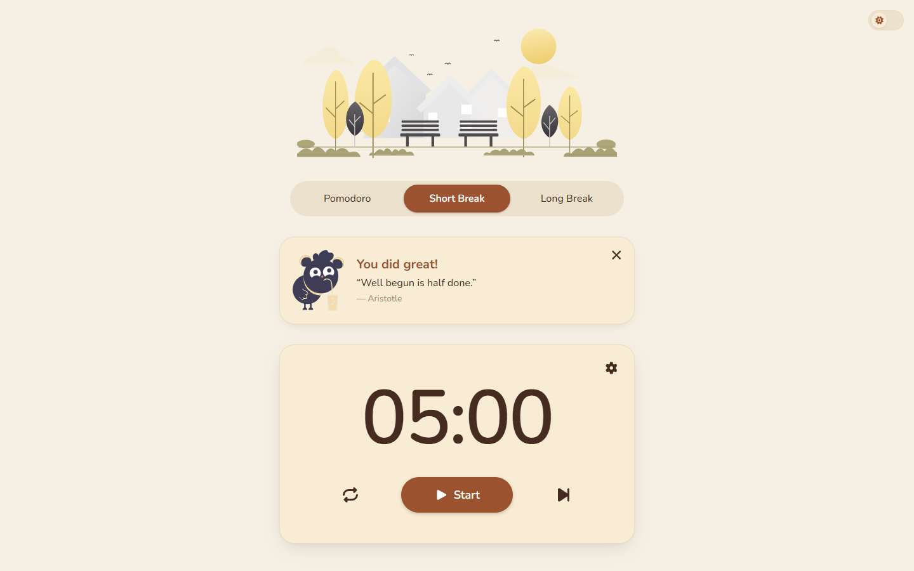

# Pomodoro Timer

[](https://pomodoro-timer-three-self.vercel.app/)

**[Live Demo →](https://pomodoro-timer-three-self.vercel.app/)**

Vue 3 · TypeScript · Pinia · Tailwind CSS · Vite · Vitest · Cypress · hexagonal architecture

<p align="center">
  <a href="https://pomodoro-timer-three-self.vercel.app/">
    
  </a>
</p>

A Pomodoro timer built with **Vue 3 + TypeScript** in a hexagonal (ports and adapters)
architecture. It cycles through **focus**, **short break** and **long break** sessions, can start
the next session on its own, and after every finished focus session shows a **success card with a
short motivational quote**.

Quotes come from the public [DummyJSON](https://dummyjson.com/docs/quotes) API by default. When
the API is down, slow or returns something unusable, the card still appears with a local quote, so
a finished session never ends in an error.

## Highlights

- **Full Pomodoro cycle:** focus → short break, with a long break after every 4th focus session
  (configurable). Switching sessions through the tabs never shifts the long-break cycle.
- **Settings:** durations of all three sessions, long-break interval, auto-start for breaks and
  for focus sessions, and the session-end sound. Invalid values keep the previous setting.
- **Survives a reload:** settings, current session and remaining time are saved in
  `localStorage`. After a reload the timer is paused, never silently running.
- **Accurate in background tabs:** the remaining time is computed from a wall-clock end time, so
  browser timer throttling can't make it drift. The countdown is shown in the browser tab title.
- **Session-end alert:** a short chime (Web Audio, no sound file) and a browser notification.
  Permission is asked on the first Start; if it's denied, the timer works silently.
- **Hexagonal monorepo:** framework-free `core`, swappable quote adapters in `infrastructure`,
  Vue in `app`. The DummyJSON API and a local mock plug into the same port.
- **Light and dark theme**, with all colours as CSS design tokens.
- **121 Vitest tests** across all three packages, plus Cypress end-to-end tests.

## Tech stack

| Area     | Tools                                                                        |
| -------- | ---------------------------------------------------------------------------- |
| Frontend | Vue 3 (Composition API), TypeScript, Pinia, Vue Router, VueUse, Font Awesome |
| Styling  | Tailwind CSS 3 with CSS-variable design tokens, light and dark mode, Nunito  |
| Build    | Vite, Yarn 1 workspaces                                                      |
| Quality  | Vitest, Vue Test Utils, Cypress, ESLint, Prettier, `vue-tsc` / `tsc`         |
| CI       | GitHub Actions: lint, type check and unit tests on every push                |

## Getting started

Requires Node.js 20 or newer (CI runs on 20) and Yarn 1.

The [live version](https://pomodoro-timer-three-self.vercel.app/) uses the DummyJSON quote API
(`VITE_QUOTE_ADAPTER=http` is set in Vercel).

```bash
yarn install
yarn workspace @pomodoro-timer/app dev   # http://localhost:5173
yarn test                                # unit tests of all packages
```

| Command                                       | What it does                                           |
| --------------------------------------------- | ------------------------------------------------------ |
| `yarn workspace @pomodoro-timer/app dev`      | dev server, quotes from DummyJSON                      |
| `yarn test`                                   | Vitest for all three packages                          |
| `yarn workspaces run type-check`              | `vue-tsc` (app) and `tsc` (core, infrastructure)       |
| `yarn lint`                                   | ESLint for the whole repository                        |
| `yarn workspace @pomodoro-timer/app build`    | type check and production build to `packages/app/dist` |
| `yarn workspace @pomodoro-timer/app preview`  | serve the production build locally                     |
| `yarn workspace @pomodoro-timer/app test:e2e` | Cypress against the production build (build first)     |

### Configuration

Copy `packages/app/.env.example` to `packages/app/.env.local` to change the defaults:

| Variable             | Default                 | Effect                                                        |
| -------------------- | ----------------------- | ------------------------------------------------------------- |
| `VITE_QUOTE_ADAPTER` | `http`                  | `http`: DummyJSON quotes API · `mock`: local JSON, no network |
| `VITE_QUOTE_API_URL` | `https://dummyjson.com` | Base URL of a DummyJSON-compatible API, used with `http`      |

Unit tests always use the mock adapter, whatever `.env.local` says, so no test calls the real API.

## Architecture

Hexagonal (ports and adapters) as a Yarn-workspaces monorepo:

```
packages/
  core/            # entities, errors, ports, services: plain TypeScript, no Vue, no fetch
  infrastructure/  # RestClient, HttpQuoteAdapter (DummyJSON) and MockQuoteAdapter (JSON file)
  app/             # Vue 3: page, components, Pinia stores, adapter selection in src/api
```

[`core`](packages/core/README.md) and [`infrastructure`](packages/infrastructure/README.md) have
their own short READMEs with their contents and test commands.

- **Dependency rule:** `app → infrastructure → core`. The app uses core's types and services
  directly and touches `infrastructure` only in `app/src/api`. Core depends on nothing, so it is
  tested without a browser or network.
- **One port, `QuotePort`:** `getRandomQuotes()` returns a batch of quotes and may throw typed
  `DomainError`s (`NetworkError`, `TimeoutError`, `ServerError`, `InvalidResponseError`).
- **`QuoteService` in core** picks what the UI shows: it keeps quotes of at most 80 characters,
  returns a random one, and falls back to one of 10 local quotes (`FALLBACK_QUOTES`) if the port
  fails or nothing is short enough. It never throws.
- **Two adapters, one format:** `HttpQuoteAdapter` and `MockQuoteAdapter` share the same two-step
  converters: `readQuotes` checks a response body at runtime, `convertQuote` maps it to core's
  `Quote`. The mock data goes through the same validation as a real response.
- **Composition root:** `createQuoteServices()` in `app/src/api` picks the adapter from
  `VITE_QUOTE_ADAPTER` and wraps it with core's `createServices`. The quote store calls it; tests
  replace this module with the mock adapter.
- **Stores:** `pomodoro-session` owns the timer (mode, remaining time, round, settings) and offers
  an `onSessionEnd` hook. `quote` loads the quote for the success card, with the states `idle`,
  `loading` and `success`; the newest load wins.
- **`@/` in every package:** a small Vite plugin (`vite-plugin-src-alias.ts`) resolves `@/…` to the
  `src` folder of the package that contains the importing file, so the app can compile core and
  infrastructure source directly.

## Quote API

| Step       | What happens                                                                                   |
| ---------- | ---------------------------------------------------------------------------------------------- |
| Trigger    | A focus session runs out; the timer has already switched to the break                          |
| Request    | `GET https://dummyjson.com/quotes/random/10` through the `RestClient`, 5 s timeout             |
| Validation | `readQuotes` checks the body: an array of `{ id, quote, author }`                              |
| Mapping    | `convertQuote`: `quote` → `text`, numeric `id` → string                                        |
| Selection  | `QuoteService` keeps quotes of at most 80 characters and picks one at random                   |
| Fallback   | Network error, timeout, 5xx/429, invalid body or only long quotes → a random local short quote |
| Display    | "You did great!" with the quote and author; "Pomodoro session completed." while it loads       |

The request runs in the background, so it never blocks the timer. With `VITE_QUOTE_ADAPTER=mock`
the quotes come from `infrastructure/src/quote-api/mock/mock-data/quotes.json` (10 entries, 2 of
them deliberately too long) after a 300 ms delay.

## Decisions and trade-offs

- **DummyJSON by default, mock in tests.** The app shows real quotes out of the box; tests stay
  fast and offline. DummyJSON sends CORS headers, so no dev proxy is needed.
- **Fallback in core, not in the UI.** `QuoteService` turns every failure into a local quote, so
  the card has no error state and the UI never has to know why a quote is local.
- **Wall-clock timer.** `setInterval` only triggers updates; the remaining time is derived from
  the end time. Background tabs throttle timers, but the countdown stays correct.
- **Round counting:** the round only advances when you move on from a _finished_ focus session,
  whether by the timer, Skip or the Pomodoro tab. Jumping to a break tab never counts as a session.
  The round is used for the long-break cycle and not shown in the UI.
- **The sound setting is separate** from the timer settings, so the app's settings stay identical
  to core's `PomodoroSettings`.
- **Light theme by default.** The theme switch doesn't follow the OS setting; dark mode is opt-in
  and remembered.
- **Accessibility:** native elements (`<dialog>`, buttons, checkboxes), `aria-pressed` on the mode
  switch, `role="timer"`, `aria-live` on the success card, visible focus outlines,
  `prefers-reduced-motion`.

### Not in scope

Session history or statistics, a task list, accounts or syncing between devices (everything is
stored per browser), and offline/PWA support.

### Known issues

- `yarn workspace @pomodoro-timer/app test:e2e` hangs on Windows because of the single quotes in
  the script. Running `vite preview` and `cypress run --e2e` separately works.
- The infrastructure package runs its tests on the root's Vitest 1.6, while app and core use
  Vitest 3. Both pass; aligning them is a cleanup for later.

## Tests

121 Vitest tests, next to the code (`*.test.ts`, `__tests__/*.spec.ts`):

- **core (19):** `QuoteService` filtering, random choice and fallback, error conversion
  (`toDomainError`), the `createServices` façade
- **infrastructure (41):** `RestClient` status → error mapping and timeout, response validation and
  mapping, `HttpQuoteAdapter` with a fake `fetch`, the mock adapter
- **app (61):** the timer store (countdown, cycle, long-break rule with tab switches, skip,
  settings validation, persistence), the quote store, the success card, the session-end alert and
  sound setting, configuration and adapter selection

Cypress covers the page in a real browser: initial state and switching modes via the tabs.

## Project structure

```
.
├── .github/workflows/main.yml      # CI: lint, type check, unit tests
├── docs/screenshot-desktop.png     # README screenshot (1440×900)
├── vite-plugin-src-alias.ts        # `@/` → src of the importing package
└── packages/
    ├── core/src/
    │   ├── entities/               # Quote, PomodoroSettings, Timer, SessionType, …
    │   ├── errors/                 # DomainError and its subclasses, toDomainError
    │   ├── ports/                  # QuotePort, PomodoroPort (planned)
    │   └── services/               # QuoteService, FALLBACK_QUOTES, createServices
    ├── infrastructure/src/
    │   ├── rest-client/            # RestClient (fetch, timeout, error mapping)
    │   └── quote-api/              # endpoints, DTO, readQuotes/convertQuote,
    │       │                       # HttpQuoteAdapter
    │       └── mock/               # MockQuoteAdapter + mock-data/quotes.json
    └── app/
        ├── cypress/                # end-to-end tests
        └── src/
            ├── api/                # composition root: createQuoteServices()
            ├── config/             # readConfig(): VITE_QUOTE_ADAPTER, VITE_QUOTE_API_URL
            ├── stores/             # pomodoro-session (timer), quote
            ├── composables/        # useSessionAlert (chime, notification, sound setting)
            ├── components/         # buttons, Modal, TextField, Checkbox, theme Switch
            │   └── Pomodoro/       # mode switch, timer card, success card
            ├── view/               # SettingsView (settings dialog)
            ├── page/               # PomodoroPage
            └── assets/             # styles (design tokens) and illustrations
```

## Roadmap

- **Timer engine in core:** core already defines `PomodoroPort` (`getSnapshot`, `setSettings`,
  `setSessionType`, `start`, `pause`, `restart`, `next`, `tick`) and the entities `Timer`,
  `SessionType`, `PomodoroSession` and `PomodoroSnapshot`. The next step is an implementation of
  that port in core, so the timer logic moves out of the Pinia store. The store's public API
  already maps one-to-one onto the port, so components won't need to change.
